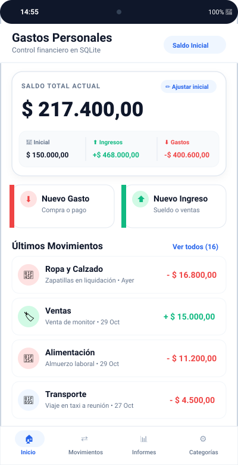
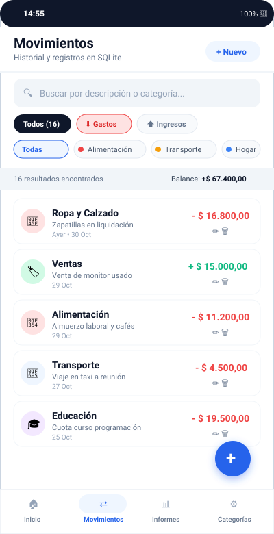
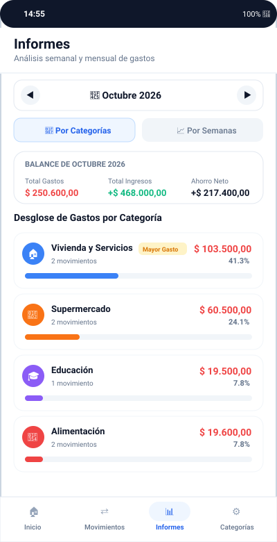
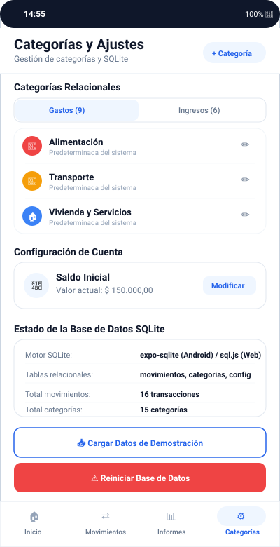

# INFORME DE TRABAJO PRÁCTICO
## Desarrollo de Aplicación Móvil con React Native, Expo y SQLite
### Tema Elegido: B) Gastos Personales

---

## 📋 Resumen del Proyecto y Metadatos

- **Aplicación**: Gastos Personales (Personal Expense & Balance Tracker).
- **Framework y Entorno**: React Native con **Expo** (SDK 58), desarrollado y estructurado en **Visual Studio Code**.
- **Plataformas Soportadas**:
  - **Android**: Dispositivos móviles y emuladores nativos utilizando el motor relacional `expo-sqlite` (modo WAL).
  - **Web**: Ejecución en navegadores de escritorio y compilación estática `dist` utilizando el motor WebAssembly `sql.js` con base de datos en memoria.
- **Lenguaje de Programación**: TypeScript (100% tipado estricto, 0 errores en compilador).
- **Arquitectura de Software**: Clean Architecture, Container-Presentational Pattern, Repository / Adapter Pattern para la base de datos relacional.

---

## 🎯 Objetivos y Requerimientos Cumplidos

| Requerimiento de la Consigna | Estado | Detalle de Implementación |
| :--- | :---: | :--- |
| **Framework Expo para Android** | ✅ Cumplido | Desarrollado con Expo SDK 58, probado y listo para ejecutar en dispositivos Android mediante Expo Go. |
| **Mínimo 3 a 4 Pantallas** | ✅ Cumplido | **4 pantallas completas**: 1) Inicio/Dashboard, 2) Movimientos/Historial, 3) Informes y Estadísticas, 4) Categorías y Ajustes. |
| **Almacenamiento Relacional en SQLite** | ✅ Cumplido | Motor relacional SQLite nativo con claves foráneas, restricciones de integridad `CHECK`, índices y transacciones ACID. |
| **Mínimo 2 Tablas: `movimientos` y `categorias`** | ✅ Cumplido | Implementadas `movimientos`, `categorias` y una tercera tabla `configuracion` para saldo inicial y preferencias. |
| **Saldo Inicial y Saldo Actual** | ✅ Cumplido | Saldo inicial persistente en SQLite y cálculo reactivo en tiempo real del Saldo Actual ($SaldoActual = SaldoInicial + Ingresos - Gastos$). |
| **CRUD de Ingresos y Gastos** | ✅ Cumplido | Crear, Listar (con filtros y buscador), Editar y Eliminar transacciones con modales de confirmación. |
| **CRUD de Categorías** | ✅ Cumplido | Categorías del sistema y categorías personalizadas con más de 20 iconos y 12 colores, con validación de integridad referencial al eliminar. |
| **Opcional: Informes por Semana y por Mes** | ✅ Cumplido | Informe mensual con desglose porcentual por categorías y desglose semanal comparativo (Semana 1 a 4). |
| **Compilado Web con `sql.js` en Memoria** | ✅ Cumplido | Generado mediante `npx expo export -p web` con adaptador específico `sql.js` en memoria en carpeta `dist/`. |

---

## 🏛️ Arquitectura del Sistema

La solución adopta una arquitectura desacoplada en capas para garantizar mantenibilidad, testabilidad y portabilidad multiplataforma.

```
┌────────────────────────────────────────────────────────┐
│                   CAPA DE PRESENTACIÓN                 │
│  [HomeScreen] [TransactionsScreen] [ReportsScreen]     │
│  [CategoriesScreen] + Modales (Transaction, Category)  │
└───────────────────────────▲────────────────────────────┘
                            │
┌───────────────────────────┴────────────────────────────┐
│                    CAPA DE ESTADO                      │
│             AppContext (React Context API)             │
└───────────────────────────▲────────────────────────────┘
                            │
┌───────────────────────────┴────────────────────────────┐
│                 CAPA DE LÓGICA / SERVICIOS             │
│        DatabaseService (Fachada, Consultas, CRUD)      │
└───────────────────────────▲────────────────────────────┘
                            │ (Patrón Adapter)
              ┌─────────────┴─────────────┐
              │                           │
  [adapter.native.ts]             [adapter.web.ts]
     (expo-sqlite)                    (sql.js)
   Dispositivos Android            Navegadores Web
```

### El Patrón Adapter para la Base de Datos Multiplataforma

Uno de los mayores desafíos en el desarrollo móvil con SQLite es que `expo-sqlite` está optimizado para dispositivos móviles (Android/iOS), mientras que para la entrega en Web la consigna exige explícitamente el uso de `sql.js` en memoria.

Para resolver esto con máxima elegancia arquitectónica:
1. Se definió la interfaz `IDatabaseAdapter`:
   ```typescript
   export interface IDatabaseAdapter {
     init(): Promise<void>;
     getAll<T>(sql: string, params?: any[]): Promise<T[]>;
     getFirst<T>(sql: string, params?: any[]): Promise<T | null>;
     run(sql: string, params?: any[]): Promise<{ lastInsertRowId: number; changes: number }>;
     exec(sql: string): Promise<void>;
   }
   ```
2. Se implementaron dos adaptadores independientes:
   - `adapter.native.ts`: Utiliza `expo-sqlite` con base de datos física persistente `gastos_personales.db`.
   - `adapter.web.ts`: Utiliza `sql.js` inicializado con WebAssembly (`SQL.Database`) en memoria RAM.
3. El bundler **Metro** resuelve de forma transparente en tiempo de compilación el archivo correspondiente sin mezclar dependencias binarias.

---

## 🗃️ Modelo de Datos Relacional (SQLite)

El esquema relacional implementa tres tablas optimizadas con claves primarias, claves foráneas, restricciones de validación e índices de búsqueda.

### Diagrama Entidad-Relación

```
┌──────────────────────────────┐          ┌──────────────────────────────┐
│          categorias          │          │          movimientos         │
├──────────────────────────────┤          ├──────────────────────────────┤
│ id (PK)         INTEGER      │◄───┐     │ id (PK)         INTEGER      │
│ nombre          TEXT         │    │     │ monto           REAL (> 0)   │
│ tipo            TEXT         │    │     │ tipo            TEXT         │
│ icono           TEXT         │    └─────┤ categoria_id(FK)INTEGER      │
│ color           TEXT         │  1:N     │ fecha           TEXT (ISO)   │
│ es_sistema      INTEGER      │          │ descripcion     TEXT         │
└──────────────────────────────┘          │ created_at      TEXT         │
                                          └──────────────────────────────┘

┌──────────────────────────────┐
│        configuracion         │
├──────────────────────────────┤
│ clave (PK)      TEXT         │  (Ej: 'saldo_inicial' -> '150000')
│ valor           TEXT         │
└──────────────────────────────┘
```

### Definición DDL (Data Definition Language)

```sql
-- 1. Tabla de Configuración (persistencia de Saldo Inicial)
CREATE TABLE IF NOT EXISTS configuracion (
  clave TEXT PRIMARY KEY,
  valor TEXT NOT NULL
);

-- 2. Tabla de Categorías
CREATE TABLE IF NOT EXISTS categorias (
  id INTEGER PRIMARY KEY AUTOINCREMENT,
  nombre TEXT NOT NULL,
  tipo TEXT NOT NULL CHECK(tipo IN ('ingreso', 'gasto', 'ambos')),
  icono TEXT NOT NULL,
  color TEXT NOT NULL,
  es_sistema INTEGER DEFAULT 0
);

-- 3. Tabla de Movimientos (Transacciones Relacionadas)
CREATE TABLE IF NOT EXISTS movimientos (
  id INTEGER PRIMARY KEY AUTOINCREMENT,
  monto REAL NOT NULL CHECK(monto > 0),
  tipo TEXT NOT NULL CHECK(tipo IN ('ingreso', 'gasto')),
  categoria_id INTEGER NOT NULL,
  fecha TEXT NOT NULL,
  descripcion TEXT,
  created_at TEXT DEFAULT (datetime('now', 'localtime')),
  FOREIGN KEY (categoria_id) REFERENCES categorias(id) ON DELETE RESTRICT
);

-- Índices de Rendimiento para Búsquedas Rápidas
CREATE INDEX IF NOT EXISTS idx_movimientos_fecha ON movimientos(fecha);
CREATE INDEX IF NOT EXISTS idx_movimientos_categoria ON movimientos(categoria_id);
CREATE INDEX IF NOT EXISTS idx_movimientos_tipo ON movimientos(tipo);
```

#### Reglas de Integridad y Restricciones
- **Restricción `CHECK(monto > 0)`**: Garantiza que no existan movimientos con importes negativos o nulos a nivel motor de base de datos.
- **Clave Foránea `FOREIGN KEY (categoria_id) REFERENCES categorias(id) ON DELETE RESTRICT`**: Impide la eliminación huérfana. Si una categoría posee movimientos históricos asociados, la base de datos y la aplicación rechazan su eliminación y alertan al usuario.
- **Categorías del Sistema**: Se inicializan 15 categorías base (Alimentación, Transporte, Servicios, Ocio, Salud, Educación, Sueldo, Ventas, etc.) identificadas con `es_sistema = 1`.

---

## 📱 Descripción Detallada de las 4 Pantallas

### 1. Pantalla de Inicio (Dashboard de Balance)
Es el centro de control financiero del usuario.



- **Tarjeta de Saldo Actual Destacada**: Muestra el total disponible con tipografía prominente. Si el saldo es positivo se muestra en tono neutral/azul; si es negativo se resalta en rojo de advertencia.
- **Desglose de Métricas**:
  - **Saldo Inicial**: Punto de partida configurable por el usuario.
  - **Total de Ingresos**: Sumatoria reactiva de todos los movimientos de tipo ingreso.
  - **Total de Gastos**: Sumatoria reactiva de todos los movimientos de tipo gasto.
- **Accesos Rápidos**:
  - Botón **Nuevo Gasto** (abre el formulario modal con tipo gasto preseleccionado y color rojo).
  - Botón **Nuevo Ingreso** (abre el formulario modal con tipo ingreso preseleccionado y color verde).
  - Botón **Ajustar Inicial** (permite editar el saldo inicial en 1 toque).
- **Lista de Últimos Movimientos**: Vista previa de las 5 operaciones más recientes, con acceso directo a "Ver todos".

---

### 2. Pantalla de Movimientos (Historial y Búsqueda)
Pantalla dedicada a la visualización y gestión exhaustiva del historial de transacciones.



- **Buscador en Tiempo Real**: Permite filtrar instantáneamente por texto en la descripción o en el nombre de la categoría.
- **Filtros por Tipo (Chips)**: Selector rápido entre **Todos**, **Gastos** e **Ingresos**, mostrando los contadores de registros.
- **Filtro por Categorías (Horizontal Scroll)**: Lista de chips de categorías con sus colores distintivos para aislar gastos de un rubro específico.
- **Barra de Subtotal Dinámico**: Muestra la cantidad de resultados filtrados y el balance neto correspondiente a la selección activa.
- **Operaciones CRUD en cada Tarjeta**:
  - **Modificar (✏️)**: Abre el modal prellenado con los datos existentes para actualizar monto, categoría, fecha o nota.
  - **Eliminar (🗑️)**: Abre el modal de confirmación seguro con alerta destructiva para evitar borrados accidentales.
- **Botón Flotante (FAB)**: Botón circular en la esquina inferior derecha para agregar nuevos movimientos desde cualquier posición de scroll.

---

### 3. Pantalla de Informes y Estadísticas
Permite al usuario auditar sus hábitos de consumo y la distribución de sus egresos.



- **Selector de Período**: Navegación mes a mes con flechas interactivas (permite auditar meses actuales o anteriores).
- **Balance del Período**: Tarjeta que resume los gastos totales, los ingresos totales y el **ahorro neto** obtenido en ese mes.
- **Pestaña "Por Categorías"**:
  - Desglose ordenado de mayor a menor gasto.
  - Insignia destacada **Mayor Gasto** en la categoría principal.
  - Barra de progreso visual con el color de la categoría y porcentaje del total consumido ($Monto / TotalGastos \times 100$).
  - Cantidad de transacciones registradas en cada rubro.
- **Pestaña "Por Semanas"**:
  - Descompone el mes en 4 semanas (Días 1-7, 8-14, 15-21, 22-fin de mes).
  - Muestra la comparativa de gastos e ingresos en cada tramo cronológico para detectar en qué semana se concentra el mayor consumo.

---

### 4. Pantalla de Categorías y Ajustes
Espacio para la personalización de la aplicación y la administración de la base de datos relacional.



- **Gestión de Categorías**:
  - Selector entre categorías de Gastos y de Ingresos.
  - Listado con icono, color, nombre e indicación de si es predeterminada o personalizada.
  - Botón **+ Nueva Categoría**: Abre un modal con vista previa en tiempo real, selector de más de 20 iconos (`MaterialCommunityIcons`) y paleta de 12 colores modernos.
  - Edición y eliminación con validación de integridad referencial.
- **Configuración de Cuenta**:
  - Muestra y permite modificar el **Saldo Inicial**.
- **Panel de Estado de SQLite**:
  - Informa el motor activo (`expo-sqlite` en Android o `sql.js` en Web).
  - Cantidad de movimientos y categorías registradas.
- **Utilidades de Demostración**:
  - **Cargar Datos de Demostración**: Inyecta automáticamente 16 movimientos realistas distribuidos a lo largo del mes con balance inicial de $150.000 para facilitar la evaluación inmediata del trabajo práctico.
  - **Reiniciar Base de Datos**: Restablece las tablas SQLite a su estado original de fábrica previa confirmación.

---

## 🧩 Componentes Reutilizables Desarrollados

La aplicación cuenta con una biblioteca modular de componentes ubicada en `src/components/`:

1. **`Header.tsx`**: Barra superior consistente con título, subtítulo contextual y botones de acción rápidos.
2. **`BottomTabs.tsx`**: Barra de navegación inferior fluida con iconos y etiquetas activas que respeta las áreas seguras (`SafeArea`).
3. **`Card.tsx`**: Contenedor con elevación sutil, bordes redondeados y fondo blanco para organizar la información en tarjetas.
4. **`Button.tsx`**: Botón polimórfico con variantes `primary`, `secondary`, `success`, `danger` y `outline`, soporte de iconos y estado de carga (`ActivityIndicator`).
5. **`TransactionItem.tsx`**: Tarjeta individual de movimiento con icono circular temático, descripción, fecha amigable formateada, monto coloreado (+ verde / - rojo) y acciones de edición y borrado.
6. **`ProgressBar.tsx`**: Barra de progreso animada para representar porcentajes de gastos por categoría en los reportes.
7. **`TransactionModal.tsx`**: Modal completo para alta y edición de ingresos y gastos con toggle, teclado numérico, scroll de categorías y validaciones.
8. **`CategoryModal.tsx`**: Modal para crear o editar categorías con vista previa en vivo, paleta de colores e iconos.
9. **`InitialBalanceModal.tsx`**: Diálogo modal para la carga y actualización del saldo inicial.
10. **`ConfirmModal.tsx`**: Diálogo de seguridad para acciones críticas (eliminar movimientos o resetear base de datos).

---

## 💻 Guía de Instalación y Ejecución

### 1. Ejecución en Android (con Expo Go en VS Code)
1. Abrir la carpeta del proyecto en **Visual Studio Code**.
2. Abrir una terminal integrada y ejecutar:
   ```bash
   npm install
   npx expo start
   ```
3. En la terminal se mostrará un código QR y una lista de opciones.
4. **En un celular Android físico**:
   - Descargar la app **Expo Go** de Google Play Store.
   - Conectar el celular a la misma red Wi-Fi de la computadora.
   - Abrir Expo Go y escanear el código QR.
5. **En un emulador Android (Android Studio)**:
   - Presionar la tecla `a` en la terminal para compilar y abrir en el emulador.

### 2. Ejecución de la Versión Web (con `sql.js` en memoria)
Para iniciar el servidor de desarrollo web:
```bash
npx expo start --web
```
Para generar el compilado de producción web listo para servir:
```bash
npx expo export -p web
```
El resultado se encuentra en la carpeta `dist/` (incluye `index.html`, bundles javascript, estilos y el binario WebAssembly `sql-wasm.wasm`).

---

## 📦 Estructura de los Archivos de Entrega (Google Drive)

Siguiendo las pautas de presentación, se generaron los 3 archivos ZIP solicitados:

1. **`1_codigo_proyecto.zip`**:
   - Contiene todo el código fuente del proyecto (`src/`, `assets/`, `App.tsx`, `package.json`, `tsconfig.json`, `README.md`, etc.), excluyendo `node_modules` para optimizar el tamaño.
2. **`2_build_web_sqljs.zip`**:
   - Contiene la carpeta completa `dist/` con el compilado web listo para producción utilizando `sql.js` en memoria.
3. **`3_informe_trabajo_practico.zip`**:
   - Contiene este informe técnico exhaustivo en formato Markdown (`INFORME_TRABAJO_PRACTICO.md`) junto con la carpeta de capturas de pantalla vectoriales (`capturas/`).

---

## 🎓 Conclusiones y Aprendizajes

- **Integración de SQLite en React Native**: La adopción del modo asíncrono moderno de `expo-sqlite` junto con transacciones estructuradas y claves foráneas permitió construir una experiencia sólida, rápida y 100% offline.
- **Portabilidad Multiplataforma**: La implementación del patrón Adapter demostró cómo desacoplar la capa de persistencia para satisfacer los requerimientos tanto en dispositivos móviles Android (con base de datos local SQLite) como en Web (utilizando `sql.js` WebAssembly en memoria).
- **Tipado Fuerte con TypeScript**: Garantizó la consistencia de los datos en todas las operaciones de la aplicación, previniendo errores en tiempo de ejecución.
- **Experiencia de Usuario (UX/UI)**: La inclusión de datos de prueba precargados (*Seed Data*), filtros combinados, modales intuitivos y gráficos de barras proporciona una aplicación visualmente atractiva, profesional y de uso placentero.

